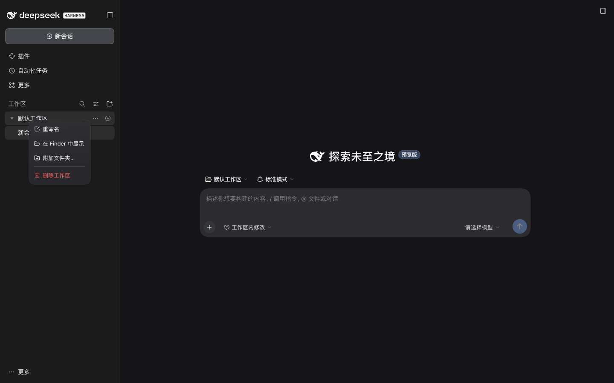
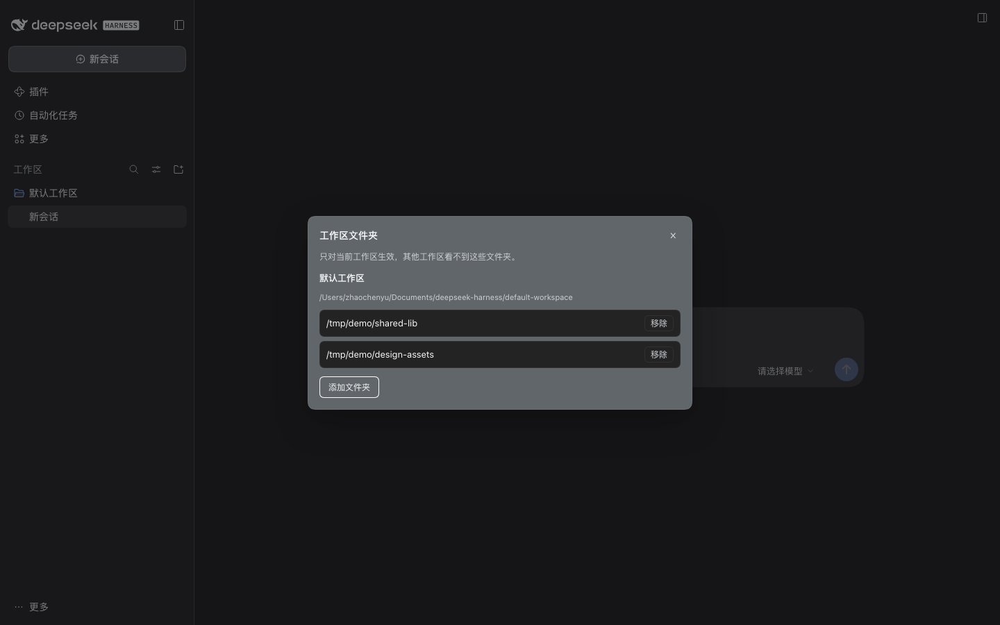

# dsh-workspace-folders


给**侧栏里的某个工作区**附加多个文件夹：附加后它们和该工作区一样可读可写（`read` / `write` / `edit` / `bash` 都认），
模型能在运行时上下文里看到它们。入口在**工作区行的右键菜单**，不需要打开任何会话；附加关系**只属于这个工作区**，
别的项目看不到也写不了。

| 右键菜单里的入口 | 管理该工作区的附加文件夹 |
| --- | --- |
|  |  |

## 能力

- **工作区级入口**：工作区行「⋯」菜单 →「附加文件夹…」→ 弹窗里增删。菜单项由官方菜单注册表
  （`ctx.contextMenus.register({ target: 'workspace' })`）提供，不改动外壳；弹窗挂在 `shell.overlay`。
- **只认侧栏工作区**：只有 `ctx.workspaceRegistry` 里注册过的工作区可以附加；删除工作区后它的附加目录**立即**不再授予可写权限，
  残留记录在下次增删或插件加载时清掉（归档工作区只归档会话，不影响附件）。
- **按工作区生效**：附件挂在 `ctx.sandboxPolicy.resolve({ session })` 上，按会话记录的 `header.cwd`（工作区根）取该工作区自己的那份列表。
  文件沙箱（`dsh-fs-sandbox`）和终端沙箱（`dsh-bash-sandbox`）都从这同一个 `resolve()` 读白名单，所以两边不会各写各的；
  换到另一个工作区的会话拿不到这些目录。目录被删掉时会自动跳过授权，不会让后续每次受限调用都报错。
- **模型可见**：一条 `workspace:folders` 运行时上下文（只列当前工作区的），外加 `workspace_folders` 工具（`list` / `add` / `remove`）。
  模型操作的就是“当前会话所属工作区”的那份数据；会话不在任何侧栏工作区里时会明确拒绝。
- **持久化**：存在 `$DSH_HOME/workspace-folders.json`（默认 `~/.dsh/workspace-folders.json`），按工作区根分桶，跨会话、跨重启保留。

## 安装

从 GitHub 安装（推荐）：

```text
dsh plugin add github:jkm6221/dsh-workspace-folders
```

或者把本目录作为 bundle 安装：

```text
plugin_manager action=install_bundle target=<本仓库克隆后的绝对路径>
```

安装后宿主半和客户端半都会热加载；页面若没变化刷新一次 Web GUI。

## 用法

```text
你点击：侧栏工作区行「⋯」→「附加文件夹…」→「添加文件夹」
你说：把 ~/work/shared-lib 加进当前工作区
模型：workspace_folders { action: "add", path: "~/work/shared-lib" }
```

移除同理：弹窗列表里点「移除」。

## 注意

- **只对当前工作区生效**：附加关系按工作区根（会话的 `header.cwd`）分桶。同一个工作区里的多个会话共享，切到别的项目就看不到、
  也写不进去；把会话 `cd` 到别处不改变这个归属。
- **状态格式**：当前是 `version: 2`（按工作区分桶）。0.1.0 的全局列表（`version: 1`）不再读取，升级后请重新附加一次。
- 只接受已存在的目录；相对路径按会话当前目录解析，`~` 会展开。
- 客户端走的是本机回环上的 `POST /workspace-folders/*`，要求 `x-dsh-plugin: workspace-folders` 头，跨站页面无法
  直接构造这种请求；请求里带工作区路径，宿主会用 workspace 注册表校验它。

## 文件

| 文件 | 作用 |
| --- | --- |
| `lib/index.js` | 宿主半：存储、沙箱授权、工具、运行时上下文、回环路由 |
| `lib/client.js` | 客户端半：工作区右键菜单项 + 文件夹弹窗（`shell.overlay`） |
| `cordis.patch.yml` | bundle 插入的插件行 |
| `locale/*.json` | 插件管理器里的标题与说明 |
| `icon.svg` | 插件图标 |
